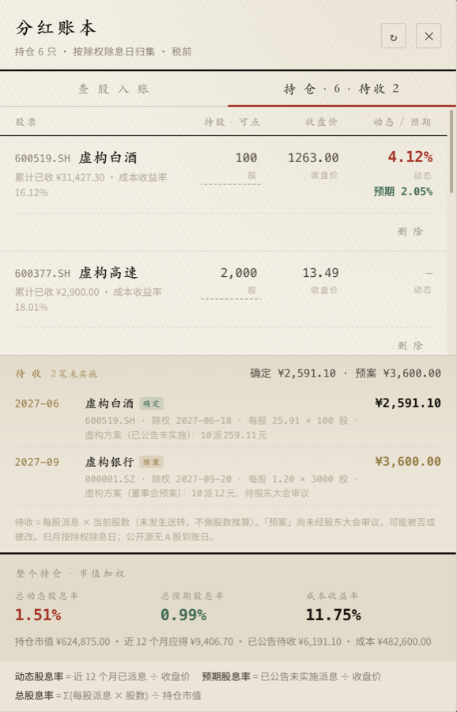
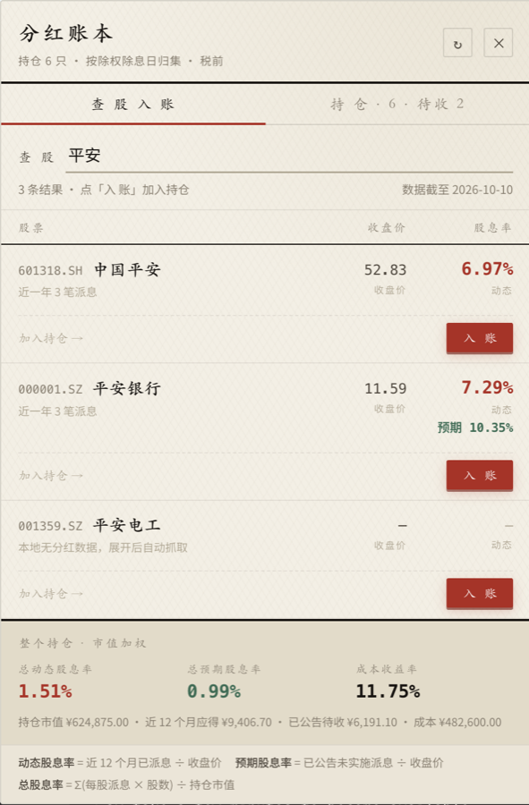

# A 股分红账本（DSH 插件）

> 你告诉它**持有哪些 A 股、从哪天开始持有、多少股**，它按分红方案算出**每只股票累计拿了多少分红、总分红占持仓成本多少**。
>
> 装在 DeepSeek Harness 里，在对话中使用。

**当前状态：核心（阶段一～三）已完成；客户端面板与 DSH 装配已实现，待在真实应用中验证。**
阶段划分与进度见 [PLAN.md](PLAN.md) 与 [PROGRESS.md](PROGRESS.md)。

---

## 环境要求

| 依赖 | 版本 | 必需性 | 说明 |
|---|---|---|---|
| **Python** | 3.11+ | **必需** | 核心只依赖标准库，**不需要 venv、不需要 `pip install`** |
| **DeepSeek Harness** | `0.2.0-rc.2` 附近 | 用插件才需要 | 纯命令行用账本不需要它 |
| **Node.js** | 22.6+ | 自行构建才需要 | 仓库已含构建产物时不需要 |
| **westock CLI** | 最新 | **联网取数才需要** | 见下 |

### 关于 westock（重要）

联网取真实分红数据依赖 **westock** 命令行工具，它**不是本项目的代码**，也**不随本仓库分发**。

- 来源：[skillhub.cn 的 westock-data skill](https://skillhub.cn/skills/tencent-adm/westock-data)（作者 tencent-adm）
- 本仓库的 `docs/westock-skill-reference/` 若存在，只是本地参考副本，**已被 `.gitignore` 排除**，请以来源为准并遵守其许可

**没有 westock 时**：账本的离线功能（记持仓、读本地事件、出报告、算指标）**全部照常可用**，
只是取不到新的分红数据。联网命令会明确报错说明缺什么，不会静默失败。

---

## 安装

### 方式一：从 npm 一键安装（推荐）

```bash
dsh plugin --profile web add dsh-stock-dividend
```

装完**完全退出并重开** DSH。包内已包含 Python 核心，**不需要克隆仓库、不需要 `npm install`**。

> 只依赖 Python 3.11+（核心仅用标准库）。联网取数另需 [westock CLI](#关于-westock重要)。

### 方式二：从源码安装（要改代码时用）

```bash
git clone https://github.com/wonderjz99/dsh-stock-dividend.git
cd dsh-stock-dividend/plugin
npm install && npm run build
```

然后在 DSH 的 **插件管理页面** 添加本插件（选"本地路径"，指向 `plugin/` 目录）。

或者直接编辑 profile 的 patch 文件，追加一行：

```yaml
- insert:
    - id: dsh-stock-dividend
      name: '/绝对路径/dsh-stock-dividend/plugin/lib/index.js'
      config:
        pythonPath: ''      # 留空自动探测 python3.12 → python3.11 → python3
        dataDir: '/绝对路径/dsh-stock-dividend/data/real'
        root: ''
        timeoutMs: 30000
```

改完**完全退出并重开** DSH（宿主模块有缓存，热改 `lib/` 不会重载）。

### 方式三：只用命令行账本

不需要 DSH、不需要 Node，只要能跑 Python：

```bash
git clone https://github.com/wonderjz99/dsh-stock-dividend.git
cd dsh-stock-dividend
python3.11 -m dividend_ledger --data data/demo --text report
```

---

## 它是什么，不是什么

| 它做 | 它不做 |
|---|---|
| 按"持仓 × 公开分红方案"推算你**应该**收到多少分红 | 读你的券商账户、看真实到账流水 |
| 按到账日（A 股拿不到时按除权除息日）汇总年 / 月 / 股票 | 预测股价、给买卖建议、选股 |
| 给出税前分红合计、成本收益率、股息率 | 定时任务、后台常驻、自动轮询 |
| 单列**已公告未实施**的待收分红（含董事会预案，标注可能被否） | 按历史规律外推"明年大概也分这么多" |
| 每个数字都能追溯到"哪次除权 × 多少股 × 每股派息" | 复刻你真实的资金流水与真实收益率 |

一句话：**它是拿公开分红方案核对你该收多少分红的对账工具，不是记账软件，也不是行情终端。**

它的可信度不来自数据多全，而来自**口径透明**：哪个数字是税前的、按哪个日期归集的、
哪一项因为缺输入算不出来——全都写在脸上，不猜、不填 0、不假装。

**三条硬边界**（不是"暂未实现"，是设计上不做）：

1. **不读账户**：不连接券商、不读登录 Cookie、不要任何密钥。
2. **不外推**：只呈现已公告的方案，绝不用历史规律预测未来。
3. **不混口径**：待收金额绝不进历史累计——"我已经收了多少"必须始终准确。

---

## 30 秒上手

核心是零依赖的 Python 包，不需要 venv、不需要 `pip install`：

克隆下来就有一份**完全虚构的**数据集 `data/demo/`，可以立刻跑通全流程：

```bash
# 1. 看数据状态
python3.11 -m dividend_ledger --data data/demo --text validate

# 2. 出报告（demo 事件已就绪，不需要先 sync）
python3.11 -m dividend_ledger --data data/demo --text report

# 3. 看持仓视图 + 两个股息率 + 待收（离线，不联网）
python3.11 -m dividend_ledger --data data/demo --text portfolio --offline
```

第 2 步会回一段这样的摘要：

```
分红账（除权除息日 17 条；人工覆盖的派息到账日 2 条）

  税前分红合计   ¥ 26,856.40
  持有成本       ¥ 482,600.00
  成本收益率     5.56%
```

**换成你自己的数据**（记得用 `data/real/`，它已被 `.gitignore` 排除，不会误提交）：

```bash
# 写入持仓（也可以直接编辑 data/real/holdings.json）
python3.11 -m dividend_ledger --data data/real --text holdings --set my-holdings.json

# 联网取真实分红数据（需要 westock CLI，见上「环境要求」）
python3.11 -m dividend_ledger --data data/real --text sync --from westock

# 出你自己的报告
python3.11 -m dividend_ledger --data data/real --text report
```

```
分红账（除权除息日 17 条；人工覆盖的派息到账日 2 条）

  税前分红合计   ¥ 26,856.40
  持有成本       ¥ 482,600.00
  成本收益率     5.56%
  股息率         1.45%
  持股数         6 只
  分红事件       19 笔
  额外获得股数   送股 10 + 转增 40

  代码          名称                    累计分红      成本收益率      股息率   笔数
  600519.SH   虚构白酒           ¥ 13,484.40      6.92%    1.54%    5
  …
  缺数据：601988.SH.cost_per_share
  另有 3 条事件因除权除息日早于开始持有日被排除

  口径：主口径税前；红利税未计入；A 股无派息到账日，按除权除息日归集
```

> 全局开关（`--data` / `--json` / `--text`）要写在子命令**之前**，例如 `--text report`。

---

## 界面：右侧账簿面板

装好后 DSH 界面右侧会出现一个竖排「分红账」立牌，点开是账簿面板。下面是真实运行的截图
（数据来自仓库自带的虚构 demo，价格与股息率是实际算出来的）：

### 持仓视图 —— 逐股股息率 + 待收 + 组合合计



一眼能看到的四件事：

1. **逐股两个股息率** —— 动态（近 12 个月已派息 ÷ 收盘价）与预期（已公告未实施 ÷ 收盘价）
2. **待收区块**（金棕描边）—— 已公告未实施的分红，**与"已收"严格分开**；
   「确定」与「预案」分别标注，预案会提示可能被否或被改
3. **组合合计条** —— 总动态 / 总预期 / 成本收益率，**按市值加权**，不是各股简单平均
4. **持股数可直接点** —— 整块是按钮（虚线提示），点一下就地改股数

### 查股视图 —— 搜索 + 入账



- **搜索**：输入代码或名称即搜（300ms 防抖），结果行显示价格与**两个股息率**
- **入账**：每行右侧的朱砂色「入 账」按钮，点开行内表单填开始持有日 / 股数 /
  每股成本（选填），**填股数时表单内实时显示两个股息率**，不必先保存
- **缺数据就说缺**：本地没有分红记录的股票显示「展开后自动抓取」，
  价格取不到就显示 `—`，**不填 0 也不猜**

### 设计方向

账簿，不是仪表盘：宣纸暖底、墨色分层、**朱砂全屏只用在「入 账」这一个动作上**（像盖章）。
表格用细分隔线 + 等宽数字右对齐——小数点必须对齐，这是账本的底线。
字体用 LXGW WenKai Screen（霞鹜文楷屏幕版）配 Noto Sans SC，不依赖系统默认字体。

## 在 DSH 对话里使用

装入 profile 后（阶段四），插件暴露四个工具：

| 工具 | 用途 |
|---|---|
| `dividend_status` | 看账本是否就绪：持仓条数、事件条数、阻塞项 |
| `dividend_holdings` | 查看 / 写入持仓 |
| `dividend_sync` | 同步分红事件 |
| `dividend_report` | 出报告，只回关键数字与文件路径 |

对话大概是这个形状：

> **你**：我持有贵州茅台 100 股，2021 年 3 月 15 日开始拿的，成本 1950。
> **它**：（调用 `dividend_holdings`）已写入。注意你没给其他股票的每股成本，那些股票的成本收益率会是空。
> **你**：算一下我的分红。
> **它**：（调用 `dividend_report`）税前分红合计 ¥…，成本收益率 …%，缺数据 …

---

## 数字是怎么算出来的

完整口径见 [SPEC.md](SPEC.md)，算法逐条见 [docs/methodology.md](docs/methodology.md)。三条最关键的：

### 1. 归属：除权除息日说了算

```
事件归到持仓  ⇔  代码相同 且 除权除息日 >= 开始持有日
```

除权除息日在你开始持有**之前**的事件不属于你——**哪怕它的派息到账日落在你持有期内**。
这条规则可解释、可复核，不做任何"按比例分配"。

### 2. 金额：每股 × 股数，全是精确十进制

```
现金分红 = 每股派息 × 股数
```

金额与比例一律用 `Decimal`，JSON 里**只有字符串，没有浮点**。
`0.1 + 0.2` 在账本里必须精确等于 `0.3`——这是拒绝 `float` 的唯一理由。

### 3. 缺失：一律 `null`，绝不用 0 冒充

| 指标 | 公式 | 缺什么会变空 |
|---|---|---|
| 成本收益率 | 累计税前分红 ÷ 持有成本 | 缺 `cost_per_share` |
| 股息率 | 现金分红 ÷ 除权除息日前市值 | 缺 `close_prev` |

缺数据时报告会列出 `missing_inputs`，例如 `601988.SH.cost_per_share`。
**`null` 比 0 诚实**：0 会让人以为"这只股票没赚到钱"，而事实是"我们不知道"。

---

## 已知的偏差与假设（请先读这一节）

### A 股没有"派息到账日"

你最初的诉求是"按到账日汇总"，但 **A 股公开数据源都不提供派息到账日**：
腾讯自选股只有 `rightRegDate` / `exDiviDate`，同花顺只有 `ex_date_ms`，
只有港股（`cashPayDate`）美股（`payDate`）才有。唯一提供 `pay_date` 的 Tushare
需要 2000 积分（200 元/年），本项目选择不购买。

所以：

- **主口径按除权除息日归集**，每条记录都标注 `date_basis`；
- 报告里永远印着"按除权除息日归集"，**绝不把除权日伪装成到账日**；
- 想变准，可以在 `data/pay_dates.json` 里手工覆盖关键记录（从券商流水抄几条）。

现金红利通常在除权后几天到两周内到账，所以**年度汇总基本不受影响，月度汇总可能偏差一个月**。

### 送转股不增加后续事件的股数

一阶段假设持有期内股数**恒定**。如果 10 送 1，你 100 股变 110 股，
下一年的分红本应按 110 股算，但这里仍按 100 股算——**持有期长的股票累计分红可能偏低**。
送股与转增股数会作为"期间额外获得 X 股"独立列出，不会悄悄消失。

要修正需要引入持仓变动事件，排在后续阶段。

### 算的是"应该收到"，不是"确实收到"

如果券商算错了，或者你中途有过场外交易导致股数与记录不符，它发现不了。
它是**对账的标尺**（拿它的数字去核券商），不是**流水的复刻**。

---

## 文件与目录

```
dsh-stock-dividend/
├── SPEC.md                     产品定义（口径、数据模型、非目标）
├── PLAN.md                     四阶段计划与验收标准
├── PROGRESS.md                 执行记录与决策日志
├── dividend_ledger/            Python 核心（零第三方依赖，python3.11+）
│   ├── codes.py                证券代码归一化
│   ├── decimals.py             Decimal 精度与舍入策略
│   ├── models.py               Holding / DividendEvent / LedgerEntry
│   ├── store.py                data/ 读写 + 自然键幂等合并
│   ├── providers/              分红事件来源
│   │   ├── base.py             DividendProvider 接口
│   │   ├── fixture.py          离线虚构数据
│   │   └── westock.py          腾讯自选股解析器（含 ÷10 量纲换算）
│   ├── ledger.py               归属匹配与单事件计算
│   ├── report.py               三分区汇总
│   ├── render.py               人读文本渲染
│   └── cli.py                  命令行入口
├── plugin/                     薄 TS 适配层（DSH 0.2.0-rc.2 契约）
│   ├── src/index.ts            apply(ctx, config) / Config
│   ├── src/tools.ts            四个 defineTool 定义
│   ├── src/python.ts           ctx.shell 调用封装（哨兵 + 沙箱策略）
│   ├── cordis.patch.yml        profile patch 层
│   └── test/                   对真实 defineTool 的契约测试
├── data/                       业务文件
│   ├── holdings.json           输入：持仓
│   ├── events.fixture.json     输入：虚构分红事件
│   ├── events.json             状态：同步后的快照
│   ├── pay_dates.json          输入（可选）：到账日覆盖表
│   └── out/                    输出：ledger.json / report.json
├── tests/                      Python 单测（218 个）
├── docs/                       口径说明与契约取证
└── scripts/                    验收脚本与宿主包抽取
```

---

## 开发与验收

```bash
bash scripts/check.sh          # 一键跑完三条验收
```

它做三件事：

1. **Python 单测**（218 个）——含端到端、幂等、零网络、零依赖守护；
2. **TS 适配层**（`tsc --noEmit` + 42 个对真实 `defineTool` 的契约测试）；
3. **幂等验收**——同一份输入连跑两次，`report.json` / `ledger.json` 逐字节一致。

TS 层需要先把宿主包从已安装的应用里抽出来（DSH 不发布 `.d.ts`，机器上也没有源码 checkout）：

```bash
node scripts/extract-dsh-packages.mjs --verify
```

### 单独跑

```bash
python3.11 -m unittest discover -s tests -t .     # Python
cd plugin && npm run check                        # TS
```

---

## 五个最容易踩的坑（都已写进测试）

1. **westock 的 `cashDiviRMB` 是"每 10 股派息（元）"**，不是每股。漏掉 ÷10 所有金额差 10 倍。
   `tests/test_westock_parser.py` 有专门的量纲回归测试。
2. **`defineTool` 的 `parameters` 是扁平属性表**，不是 `type/properties/required` 包裹；
   `output` 必须是 `{ schema, render }`。社区文档里流传的写法在 0.2.0-rc.2 会直接抛错。
3. **`timeoutMs` 只是声明式**——工具注册表不强制超时，调用必须自己带超时并能被取消。
4. **子进程必须走 `ctx.shell` 并显式传 `sandboxPolicy`**，否则拿到的是无沙箱子进程。
5. **`dsh plugin --profile desktop add` 会被 CLI 拒绝**——desktop profile 由应用独占管理，
   安装只能走应用内插件页或 `plugin_manager` 工具。

前两条来自实证，详见 [docs/dsh-plugin-contract-0.2.0-rc.2.md](docs/dsh-plugin-contract-0.2.0-rc.2.md)
（含 [V] 已验证 / [D] 官方文档 / [I] 推断 / [C✗] 被推翻 分级）。

---

## 文档索引

| 文档 | 内容 |
|---|---|
| [SPEC.md](SPEC.md) | 产品定义：目标、数据模型、业务口径、输入输出契约、非目标、风险 |
| [PLAN.md](PLAN.md) | 六阶段计划与当前状态、各阶段验收标准、决策日志 |
| [PROGRESS.md](PROGRESS.md) | 执行记录：环境事实、取证结论、31 个已修缺陷、遗留问题 |
| [docs/methodology.md](docs/methodology.md) | 算法与口径逐条说明（含每个公式为什么这样） |
| [docs/data-source-selection.md](docs/data-source-selection.md) | 分红数据源三方对比与选型决策 |
| [docs/dsh-plugin-contract-0.2.0-rc.2.md](docs/dsh-plugin-contract-0.2.0-rc.2.md) | DSH 插件契约实证（449 行，带来源分级） |
| [data/README.md](data/README.md) | 虚构数据覆盖了哪些边界场景 |
| [data/demo/README.md](data/demo/README.md) | 开箱即用的虚构数据集说明 |
| [发布清单](docs/publishing-checklist.md) | 推到 GitHub / 给别人用之前要逐项确认的东西 |

---

## 许可

[MIT](LICENSE)。你可以自由使用、修改、分发、商用，只需保留版权声明。

**第三方内容不属于本许可范围**：

| 内容 | 说明 |
|---|---|
| westock CLI / westock-data skill | 来源 [skillhub.cn](https://skillhub.cn/skills/tencent-adm/westock-data)，作者 tencent-adm，**不随本仓库分发** |
| DeepSeek Harness 及其 `@deepseek-ai/*` 包 | 版权归 DeepSeek，本仓库只以 `peerDependencies` 引用，**不含其代码** |

数据来源免责：分红数据来自公开渠道，**可能有错、可能滞后**，请以交易所与上市公司公告为准。
本项目不对任何投资决策负责。

---

## 隐私与安全

- **不连接真实账户，不读取登录 Cookie，不上传任何数据。**
- 一阶段**全程不联网**：`tests/test_acceptance.py` 里有守护测试，核心源码出现任何网络调用都会失败。
- 所有数据都在你本机 `data/` 下；`data/out/` 是派生结果，删掉随时能重新生成。
- `.gitignore` 已排除 `data/*.local.json`，真实持仓不要入库。
# dsh-stock-dividend
